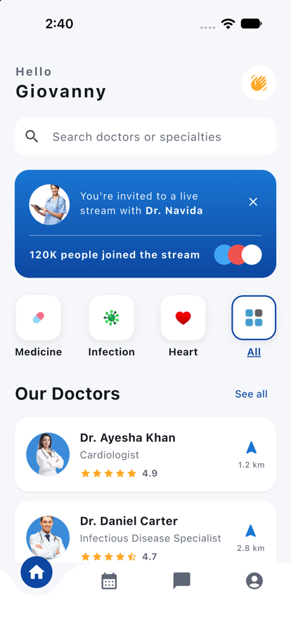
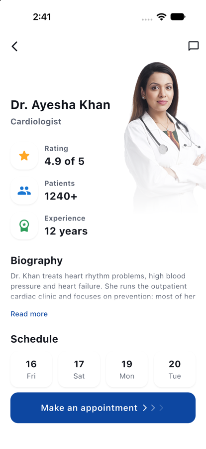
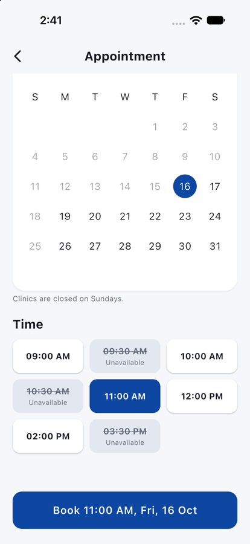
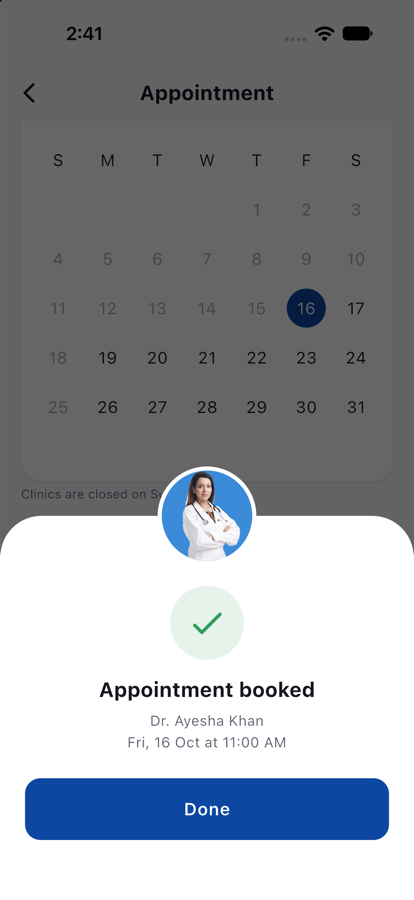
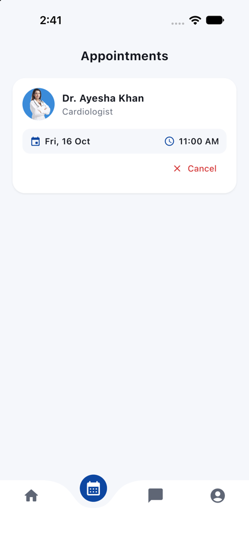
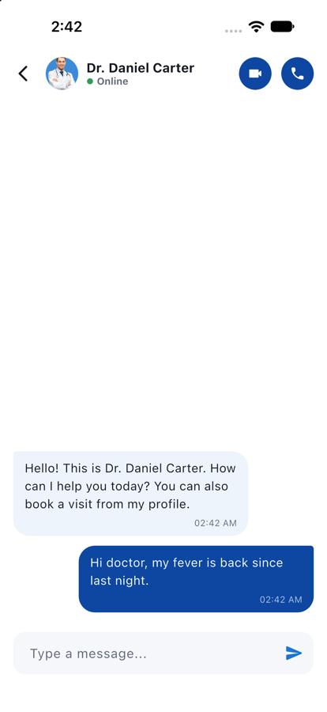

# Doctor Appointment App

A Flutter app for finding a doctor, chatting with them and booking an appointment. It runs entirely on sample data, so there is no backend to set up.

<p align="center">
  
  
  
</p>
<p align="center">
  
  
  
</p>

## Features

- **Find a doctor:** live search by name or specialty, plus Medicine / Infection / Heart category filters. The "See all" list is sorted by distance and has its own search.
- **Doctor profiles:** photo, rating, patient count, experience, an expandable biography, and the next four working days. Tapping a day opens booking on that date.
- **Booking:** a calendar limited to the next 60 days with Sundays closed, and a grid of time slots. Past slots and slots other patients have taken are struck through and can't be picked. You also can't book two doctors at the same time.
- **Appointments tab:** upcoming visits, soonest first, with cancel and undo.
- **Messages:** one thread per doctor, with the last message shown in the inbox.
- **Small touches:** staggered entry animations (skipped when the system asks for reduced motion), screen-reader labels on icon-only buttons and slots, and ratings shown as a number as well as stars.

Bookings and messages live in memory, so they reset when the app is closed.

## Tech stack

Plain Flutter with Material 3. The only package is [`curved_navigation_bar`](https://pub.dev/packages/curved_navigation_bar) for the bottom bar. The calendar is Flutter's own `CalendarDatePicker`.

## Architecture

```
lib/
├── main.dart          app entry; wires up AppScope and the theme
├── data/              the sample doctor list and searchDoctors()
├── model/             Doctor, Appointment, ChatMessage
├── view_model/
│   ├── appointment_book.dart   books, cancels and lists appointments
│   ├── chat_log.dart           message threads per doctor
│   └── app_scope.dart          InheritedWidget that hands both down
├── view/              screens (splash, home, doctors, profile, booking,
│                      chat, messages, appointments, account) and shared widgets
├── res/               colours and ThemeData
└── utils/             time slots, working days, date formatting
```

`AppointmentBook` and `ChatLog` are `ChangeNotifier`s. Screens read them through `AppScope.of(context)` and rebuild with `ListenableBuilder`. Both take an injectable clock, which is how the tests pin "now" to a fixed date.

Which slots are taken by other patients comes from a fixed hash of the doctor and time (`isTakenByOthers` in `utils/schedule.dart`), so the same slots stay unavailable between runs without a server.

## Getting started

Requirements: Flutter 3.32+ (Dart 3.8+).

```bash
git clone https://github.com/OmerJahangir/doctors_appointment_app.git
cd doctors_appointment_app
flutter pub get
flutter run
```

It runs on Android and iOS. The web and desktop folders are the standard Flutter templates.

## Testing

```bash
flutter test
```

Unit tests cover search, slot and working-day rules, date formatting, booking rules (past, taken, double-booked, clashes), cancel/undo and chat. Widget tests walk through the main flows: splash to home, search and category filters, booking and cancelling an appointment, taken slots, and sending a message.

## License

[MIT](LICENSE) © Omer Jahangir
